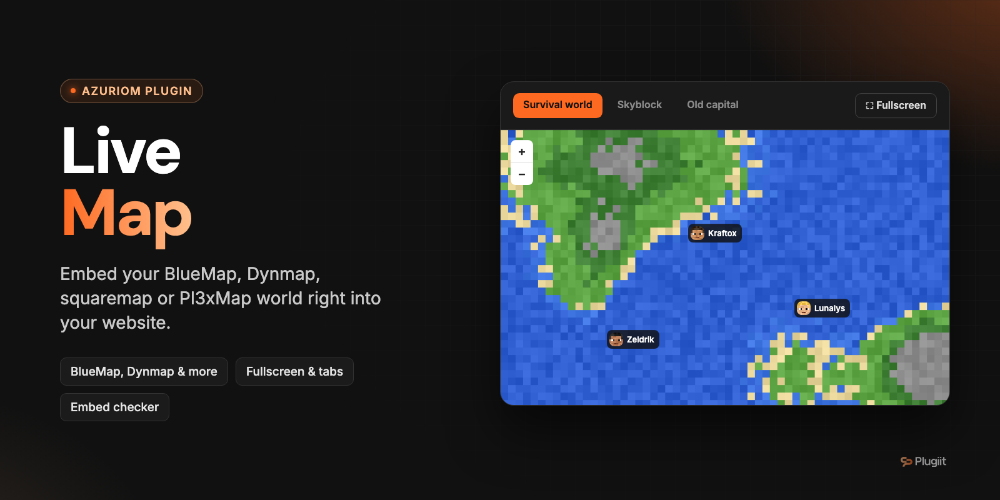

# Plugiit Live Map

Embed one or more live Minecraft web maps (BlueMap, Dynmap, squaremap, Pl3xMap or any URL) right into your Azuriom website.

Azuriom plugin · v1.0.0 · by Plugiit

## Features

- **Public map page** at `/plugiit-live-map` with tabs to switch between maps (a dropdown selector on mobile).
- **Direct link per map**: `/plugiit-live-map/{id}`.
- **Supported map types**: BlueMap, Dynmap, squaremap, Pl3xMap and custom URL (Overviewer, home-made map, etc.), each with its own default icon.
- **Responsive iframe** with lazy loading (`loading="lazy"`) and a loading indicator.
- **Fullscreen button** (Fullscreen API, WebKit prefix supported) and **"Open in a new tab"** link.
- **Fallback message** when the map does not load within 15 seconds, with a "Retry" button and a direct link to the map.
- **Optional linked Azuriom server**: the page shows whether the server is online and how many players are connected.
- **Embed test** in the admin panel: the web server requests the map URL, checks that it answers and analyzes the `X-Frame-Options` and `Content-Security-Policy: frame-ancestors` headers. When embedding is blocked, the fix to apply on the map server or reverse proxy is explained (with an Nginx example). Mixed content (HTTPS website, HTTP map) is reported too.
- **Theme widget** to display a map anywhere in a theme.
- Action log entries for map creation, update and deletion, and for settings changes.
- English and French translations.

## Requirements

- Azuriom `1.1.0` or later (`azuriom_api` 1.1.0).
- A web map reachable over HTTP(S) from your visitors' browsers. If your website uses HTTPS, the map must use HTTPS too.

## Installation

**From the Azuriom Market** (recommended): install and enable the plugin from **Admin → Plugins**.

**Manually**:

1. Copy the plugin into the `plugins/` directory of your Azuriom installation. The folder **must be named after the plugin ID**, not after the repository:

   ```
   plugins/plugiit-live-map/
   ```

2. Enable the plugin from **Admin → Plugins**. The migrations (table `plugiit_live_map_maps`) run on activation.
3. Add the page to your navbar: **Admin → Navbar → Add**, type "Plugin", route "Server map".

## Configuration

### Permission

| Permission | Description |
| --- | --- |
| `plugiit-live-map.admin` | Manage live maps |

### Maps

**Admin → Live map → Maps** (`/admin/plugiit-live-map/maps`): create, edit and delete maps.

| Field | Description |
| --- | --- |
| Name | Displayed in the tabs and page title (max. 100 characters). |
| Map type | BlueMap, Dynmap, squaremap, Pl3xMap or Custom URL. |
| Public map URL | The map address as opened in a browser (`http` or `https` only). |
| Linked server | Optional Azuriom server whose status and player count are displayed. |
| Icon | Optional Bootstrap Icons class (e.g. `bi bi-map`). Empty = default icon of the type. |
| Position | Display order (ascending). |
| Display this map | Disabled maps are hidden from the public page and the widget. |

Use the **Test the URL** button next to the URL field to check that the map can be embedded before saving.

### Settings

**Admin → Live map → Settings** (`/admin/plugiit-live-map/settings`):

| Setting | Default | Description |
| --- | --- | --- |
| Map height | 650 px | Between 250 and 2000 px. Limited to 75% of the screen height on mobile. |
| Map displayed by default | First enabled map | Map shown on `/plugiit-live-map`. |
| Display the fullscreen button | On | Also applies to the widget. |
| Display the "Open in a new tab" link | On | Public page only. |

## Usage

### Public pages

| Page | URL |
| --- | --- |
| Default map | `/plugiit-live-map` |
| Specific map | `/plugiit-live-map/{id}` |

### Theme widget

```blade
@include('plugiit-live-map::widget')
@include('plugiit-live-map::widget', ['mapId' => 2, 'height' => 350, 'title' => false])
```

| Parameter | Default | Description |
| --- | --- | --- |
| `mapId` | Default map | ID of an enabled map. |
| `height` | `400` | Height in pixels. |
| `title` | `true` | `false` hides the header (map name and "Open the full map" link). |

Nothing is rendered when there is no enabled map (or when `mapId` does not match an enabled map).

## Troubleshooting

### The map refuses to load in the iframe

Run **Test the URL** in the map form. If the test reports that embedding is forbidden, your website must be allowed on the map side. The built-in web servers of BlueMap, Dynmap, squaremap and Pl3xMap do not send these headers by default: they usually come from a reverse proxy or a hosting provider. Nginx example:

```nginx
proxy_hide_header X-Frame-Options;
add_header Content-Security-Policy "frame-ancestors 'self' https://your-website.com";
```

### Blank map on an HTTPS website

Browsers block HTTP content inside an HTTPS page (mixed content). Serve the map over HTTPS, for example behind a reverse proxy with a certificate.

## Support

Open an issue on GitHub or contact Plugiit.

## Contributing

Issues and pull requests are welcome.

## License

License: to be defined.
